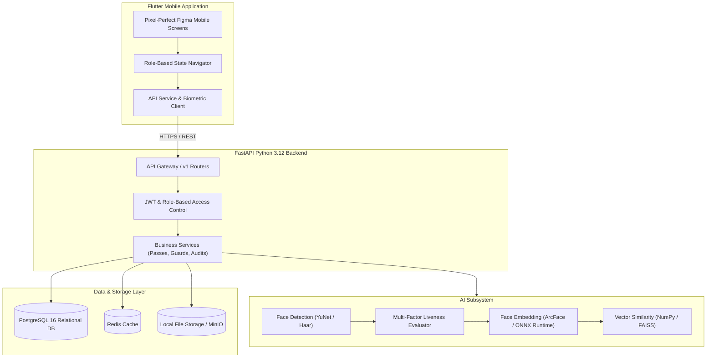

# Campus Secure - System Architecture

## Overview
Campus Secure is an enterprise-grade campus access control, identity verification, and security management platform for **Trichy SRM Medical College Hospital & Research Centre**.

The platform is designed around strict separation of concerns, multi-role mobile operations, high-speed face biometrics, and immutable security audit trails.

## Technology Stack & Verified Versions
* **Mobile Frontend:** Flutter 3.19+ with Dart 3.3+, Material Design & Cupertino icons.
* **Backend Framework:** Python 3.12.7 with FastAPI 0.115.2 and Uvicorn 0.31.0.
* **Database & ORM:** PostgreSQL 16+ with SQLAlchemy 2.0.35 and Alembic 1.13.3.
* **Security & Auth:** OAuth2 password flow with JWT (python-jose 3.3.0) and Bcrypt (4.0.1).
* **AI & Computer Vision:** OpenCV 4.10, ONNX Runtime 1.19.2, NumPy 1.26.4.
* **Data Processing:** OpenPyXL 3.1.5, Pandas 2.2.3.
* **Containerization:** Docker & Docker Compose with multi-stage builds.
